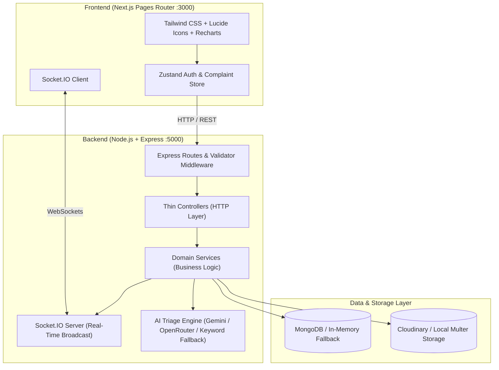
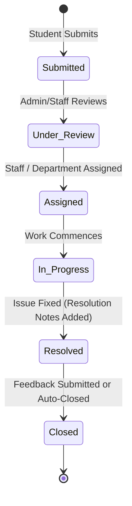

# CampusResolve – College Complaint Management System

> **Single Source of Truth:** This repository is architected and implemented strictly according to the specifications defined in [spec.md](spec.md).

---

## 📌 Table of Contents
- [Overview](#-overview)
- [Key Features](#-key-features)
- [System Architecture](#-system-architecture)
- [Folder Structure](#-folder-structure)
- [Prerequisites](#-prerequisites)
- [Step-by-Step Local Setup Guide](#-step-by-step-local-setup-guide)
  - [1. Clone / Open Repository](#1-clone--open-repository)
  - [2. Backend Setup (`server/`)](#2-backend-setup-server)
  - [3. Frontend Setup (`client/`)](#3-frontend-setup-client)
  - [4. Running the Application](#4-running-the-application)
- [Environment Configuration](#-environment-configuration)
  - [Backend Environment Variables (`server/.env`)](#backend-environment-variables-serverenv)
  - [Frontend Environment Variables (`client/.env.local`)](#frontend-environment-variables-clientenvlocal)
- [Default Test Credentials & Seeding](#-default-test-credentials--seeding)
- [API Reference](#-api-reference)
- [Status Lifecycle State Machine](#-status-lifecycle-state-machine)
- [AI Engine & Keyword Fallback](#-ai-engine--keyword-fallback)
- [Troubleshooting & FAQ](#-troubleshooting--faq)
- [Implementation Roadmap](#-implementation-roadmap)

---

## 🏢 Overview

**CampusResolve** is a full-stack, enterprise-grade web platform designed for universities and colleges to streamline student grievance handling across hostels, infrastructure, Wi-Fi, academics, and cleanliness. 

### Core Highlights:
- **Intelligent Triage:** Raw complaint text is analyzed by an AI categorization engine (Google Gemini or OpenRouter) to automatically infer department, urgency priority, and concise summaries.
- **Zero-Downtime Fallback:** A deterministic rule-based keyword matching engine runs automatically if AI keys are omitted or external APIs face downtime.
- **Real-Time Notification Pipeline:** Live status updates stream instantly to student and administrator dashboards via Socket.IO.
- **Auditable Lifecycle Tracking:** Every status transition writes an immutable `ComplaintLog` event ensuring complete transparency.

---

## ✨ Key Features

| Role | Capabilities |
| :--- | :--- |
| **Student** | • Register and authenticate with student credentials.<br>• Submit tickets with title, category, location, priority, description, and image evidence.<br>• Live AI category preview while typing.<br>• Interactive real-time timeline tracking status changes.<br>• Submit post-resolution satisfaction rating & feedback once marked `Resolved`. |
| **Admin & Staff** | • Aggregated metric dashboard with SLA breach alerts and department breakdown.<br>• Filter, search, and bulk manage complaints.<br>• Assign tickets to specific departments or staff members.<br>• Update status (`Under Review` → `Assigned` → `In Progress` → `Resolved` → `Closed`) with mandatory resolution notes. |
| **System** | • Automatic AI categorization & sentiment priority inference.<br>• Deterministic keyword fallback engine.<br>• Real-time notifications emitted via Socket.IO.<br>• In-memory MongoDB fallback for frictionless zero-config local testing. |

---

## 🏗 System Architecture



---

## 📂 Folder Structure

The repository follows a clean, decoupled client-server architecture as mandated by `spec.md`:

```text
college_complaint_management/
├── spec.md                     # Single source of truth specifications
├── README.md                   # Local setup and operations guide
├── package.json                # Root scripts (concurrent execution)
├── client/                     # Frontend Next.js Application
│   ├── package.json
│   ├── next.config.js
│   ├── tailwind.config.js
│   ├── postcss.config.js
│   ├── .env.local              # Frontend environment config
│   └── src/
│       ├── components/
│       │   ├── AppShell/       # Header, navigation drawer, notification bell
│       │   ├── MetricGrid/     # KPI cards for complaints & resolution rates
│       │   ├── ComplaintCard/  # Ticket cards with status badges
│       │   ├── TimelineView/   # Interactive chronological status history
│       │   ├── FileUploader/   # Image attachment dropzone
│       │   └── ProtectedRoute/ # Role-based route guard
│       ├── pages/
│       │   ├── _app.js         # Global shell, styles, and store provider
│       │   ├── index.js        # Landing page with role-based redirection
│       │   ├── login.js        # Authentication page
│       │   ├── register.js     # Student registration page
│       │   ├── dashboard.js    # Student personal console
│       │   ├── settings.js     # User profile and security preferences
│       │   ├── admin/
│       │   │   ├── dashboard.js            # Admin analytics & ticket management
│       │   │   └── complaints/[id].js     # Admin ticket processing & assignment
│       │   └── complaints/
│       │       ├── new.js                  # New complaint submission & live AI preview
│       │       └── [id].js                 # Detailed complaint timeline & feedback
│       ├── store/
│       │   ├── authStore.js                # JWT & session state
│       │   └── complaintStore.js           # Live tickets & filter state
│       └── services/
│           ├── api.js                      # Axios instance with auth interceptor
│           └── socket.js                   # Client-side Socket.IO listener
│
└── server/                     # Backend Express API & Real-Time Engine
    ├── package.json
    ├── .env                    # Backend environment config
    └── src/
        ├── config/
        │   ├── env.js          # Validated environment configuration
        │   ├── db.js           # MongoDB connection with in-memory fallback
        │   └── socket.js       # Socket.IO initialization and rooms
        ├── routes/
        │   ├── authRoutes.js         # /api/auth
        │   ├── complaintRoutes.js    # /api/complaints
        │   ├── adminRoutes.js        # /api/admin
        │   └── notificationRoutes.js # /api/notifications
        ├── controllers/
        │   ├── authController.js
        │   ├── complaintController.js
        │   └── adminController.js
        ├── services/
        │   ├── authService.js
        │   ├── complaintService.js
        │   ├── aiService.js          # Gemini / OpenRouter / Keyword fallback
        │   └── notificationService.js
        ├── models/
        │   ├── User.js               # User accounts (student, admin, staff)
        │   ├── Complaint.js          # Primary ticket documents
        │   ├── ComplaintLog.js       # Chronological audit timeline events
        │   └── Notification.js       # In-app alerts
        └── middleware/
            ├── authMiddleware.js     # JWT verification & role authorization
            └── errorMiddleware.js    # Global centralized error handler
```

---

## ⚙️ Prerequisites

Before running the application locally, ensure you have the following installed:

1. **Node.js**: `v18.0.0` or higher (Tested on Node `v24.x`)
   ```bash
   node -v
   ```
2. **npm**: `v9.0.0` or higher
   ```bash
   npm -v
   ```
3. **MongoDB**: 
   - Option A (Recommended): Local MongoDB instance running on `mongodb://localhost:27017`
   - Option B: MongoDB Atlas cloud connection URI
   - Option C (Zero-Config): If `MONGO_URI` is omitted or local MongoDB is offline, the backend automatically initializes an in-memory database (`mongodb-memory-server`) for development!
4. **Git**: Installed and available in your terminal path.

---

## 🚀 Step-by-Step Local Setup Guide

### 1. Clone / Open Repository
Open your terminal in the project directory:
```bash
cd college_complaint_management
```

---

### 2. Backend Setup (`server/`)

1. **Navigate into the server folder:**
   ```bash
   cd server
   ```

2. **Install backend dependencies:**
   ```bash
   npm install
   ```

3. **Configure the environment file:**
   Create a `.env` file in the `server/` root directory:
   ```bash
   # On Windows PowerShell:
   New-Item -ItemType File -Name .env -Force
   # Or copy from example:
   cp .env.example .env
   ```
   *(See [Backend Environment Variables](#backend-environment-variables-serverenv) below for exact values)*

4. **(Optional) Seed Default Test Users & Sample Complaints:**
   ```bash
   npm run seed
   ```

---

### 3. Frontend Setup (`client/`)

1. **Open a new terminal and navigate to the client folder:**
   ```bash
   cd college_complaint_management/client
   ```

2. **Install frontend dependencies:**
   ```bash
   npm install
   ```

3. **Configure the environment file:**
   Create a `.env.local` file in the `client/` root directory:
   ```bash
   # On Windows PowerShell:
   New-Item -ItemType File -Name .env.local -Force
   # Or copy from example:
   cp .env.example .env.local
   ```
   *(See [Frontend Environment Variables](#frontend-environment-variables-clientenvlocal) below)*

---

### 4. Running the Application

You can run both services independently or simultaneously:

#### Terminal 1 — Start the Backend Server:
```bash
cd server
npm run dev
```
> The API server will boot on `http://localhost:5000`. Socket.IO will attach to the HTTP listener.

#### Terminal 2 — Start the Next.js Frontend:
```bash
cd client
npm run dev
```
> The web interface will boot on `http://localhost:3000`.

#### Single-Command Root Execution (Optional):
From the project root (`college_complaint_management/`):
```bash
npm run dev
```
*(Runs both client and server concurrently)*

Visit **[http://localhost:3000](http://localhost:3000)** in your browser!

---

## 🔐 Environment Configuration

### Backend Environment Variables (`server/.env`)

Save the following in `server/.env`:

```env
# Server Port & Execution Mode
PORT=5000
NODE_ENV=development

# Allowed Client Origin (for Helmet & CORS)
CLIENT_URL=http://localhost:3000

# Database Configuration
# Leave blank or use default; will automatically use in-memory DB if local MongoDB is not running
MONGO_URI=mongodb://localhost:27017/campusresolve

# JWT Secret & Expiry
JWT_SECRET=super_secret_campus_resolve_jwt_key_2026
JWT_EXPIRES_IN=7d

# AI Categorization Engine
# Options: "gemini" | "openrouter" | "keyword"
AI_PROVIDER=keyword
GEMINI_API_KEY=your_gemini_api_key_here
OPENROUTER_API_KEY=your_openrouter_api_key_here

# File Upload Storage (Optional - falls back to local uploads folder)
STORAGE_TYPE=local
CLOUDINARY_CLOUD_NAME=
CLOUDINARY_API_KEY=
CLOUDINARY_API_SECRET=
```

### Frontend Environment Variables (`client/.env.local`)

Save the following in `client/.env.local`:

```env
# Backend API Base URL
NEXT_PUBLIC_API_URL=http://localhost:5000/api

# Real-Time WebSocket URL
NEXT_PUBLIC_SOCKET_URL=http://localhost:5000
```

---

## 👥 Default Test Credentials & Seeding

Running `npm run seed` in `server/` populates the database with initial users:

| Role | Email | Password | Student / Dept ID |
| :--- | :--- | :--- | :--- |
| **Administrator** | `admin@campusresolve.edu` | `Admin@123` | Dept: `Campus Administration` |
| **Student** | `student@campusresolve.edu` | `Student@123` | ID: `STU-2026-001` |
| **Staff (Hostel)**| `hostel.staff@campusresolve.edu` | `Staff@123` | Dept: `Hostel Affairs` |

---

## 📡 API Reference

All protected endpoints require an `Authorization: Bearer <token>` header.

### 1. Authentication (`/api/auth`)
| Method | Endpoint | Access | Description |
| :--- | :--- | :--- | :--- |
| `GET` | `/api/health` | Public | System heartbeat & DB status check |
| `POST` | `/api/auth/register` | Public | Register a new student account |
| `POST` | `/api/auth/login` | Public | Authenticate user & receive JWT token |
| `GET` | `/api/auth/me` | Authenticated | Retrieve authenticated user profile |

### 2. Complaints (`/api/complaints`)
| Method | Endpoint | Access | Description |
| :--- | :--- | :--- | :--- |
| `GET` | `/api/complaints` | Authenticated | List complaints (with pagination, status & category filters) |
| `POST` | `/api/complaints` | Student | Submit new complaint (triggers AI triage pipeline) |
| `GET` | `/api/complaints/:id` | Authenticated | Retrieve single complaint with complete `ComplaintLog` timeline |
| `PUT` | `/api/complaints/:id/status` | Admin / Staff | Update status (`Under Review`, `In Progress`, `Resolved`, etc.) |
| `PUT` | `/api/complaints/:id/assign` | Admin | Assign ticket to department or staff member |
| `POST` | `/api/complaints/:id/feedback`| Student | Submit resolution satisfaction score (1-5) and feedback notes |
| `DELETE` | `/api/complaints/:id` | Admin | Archive or delete a complaint |

### 3. Admin & Notifications (`/api/admin` & `/api/notifications`)
| Method | Endpoint | Access | Description |
| :--- | :--- | :--- | :--- |
| `GET` | `/api/admin/stats` | Admin | Aggregated metrics, SLA breaches, category analytics |
| `GET` | `/api/notifications` | Authenticated | Get user's unread & recent notifications |
| `PUT` | `/api/notifications/:id/read` | Authenticated | Mark a specific notification as read |

---

## 🔄 Status Lifecycle State Machine

Complaints strictly traverse the following stages:



- Each transition triggers:
  1. An immutable audit record in `ComplaintLogs`.
  2. A real-time `status_update` event emitted across Socket.IO.
  3. A persistent `Notification` document created for the student.

---

## 🤖 AI Engine & Keyword Fallback

When a complaint is submitted:
1. `aiService.js` examines the raw title and description.
2. If `GEMINI_API_KEY` or `OPENROUTER_API_KEY` is present and valid, the LLM infers:
   - **Category:** `hostel`, `wifi`, `infrastructure`, `academics`, `cleanliness`, or `other`.
   - **Priority:** `low`, `medium`, `high`, `critical`.
   - **AI Summary:** 1–2 sentence operational executive summary.
3. If no API key is provided, or in case of network timeouts, the **Keyword Rule Engine** automatically classifies based on university-specific lexicons (e.g., words like *"leak"*, *"router"*, *"ac"*, *"mess"*, *"exam"*).

---

## ❓ Troubleshooting & FAQ

### 1. `EADDRINUSE: address already in use :::5000`
- **Cause:** Another process is running on port 5000.
- **Solution:** 
  - Change `PORT=5001` in `server/.env` and update `NEXT_PUBLIC_API_URL` / `NEXT_PUBLIC_SOCKET_URL` in `client/.env.local`.
  - Or terminate the conflicting process on Windows:
    ```powershell
    Get-Process -Id (Get-NetTCPConnection -LocalPort 5000).OwningProcess | Stop-Process -Force
    ```

### 2. What if I don't have MongoDB installed locally?
- **Zero-config in-memory database:** The backend automatically leverages `mongodb-memory-server` if local MongoDB is unreachable. You do not need to install MongoDB to run and test the application!

### 3. Socket.IO connection failure in browser console
- Ensure the backend server is running on port 5000.
- Verify `NEXT_PUBLIC_SOCKET_URL=http://localhost:5000` is present in `client/.env.local` and restart the client.

### 4. AI categorization is returning default values
- Make sure either `GEMINI_API_KEY` or `OPENROUTER_API_KEY` is set in `server/.env`, and `AI_PROVIDER` is set to `gemini` or `openrouter`.
- If using the keyword engine (`AI_PROVIDER=keyword`), classification runs entirely offline using built-in campus rule heuristics.

---

## 🗺 Implementation Roadmap

As outlined in [spec.md](spec.md#L128-L134), the system develops across 6 structured phases:

- [ ] **Phase 1:** Project setup (Next.js Pages Router, Express server, MongoDB / in-memory connection, JWT auth, Zustand auth store, AppShell layout).
- [ ] **Phase 2:** Complaint submission form, image upload configuration, basic student complaint list, and detail view.
- [ ] **Phase 3:** AI auto-categorization integration (OpenRouter/Gemini primary, keyword engine fallback).
- [ ] **Phase 4:** Admin dashboard, status management lifecycle, and staff assignment workflow.
- [ ] **Phase 5:** Socket.IO real-time notification streaming, activity timeline logging, and student feedback rating system.
- [ ] **Phase 6:** End-to-end deployment setup (Vercel for frontend, Render for backend, MongoDB Atlas for database).

---

## 📄 License
This project is developed for educational and institutional governance purposes under the MIT License.
